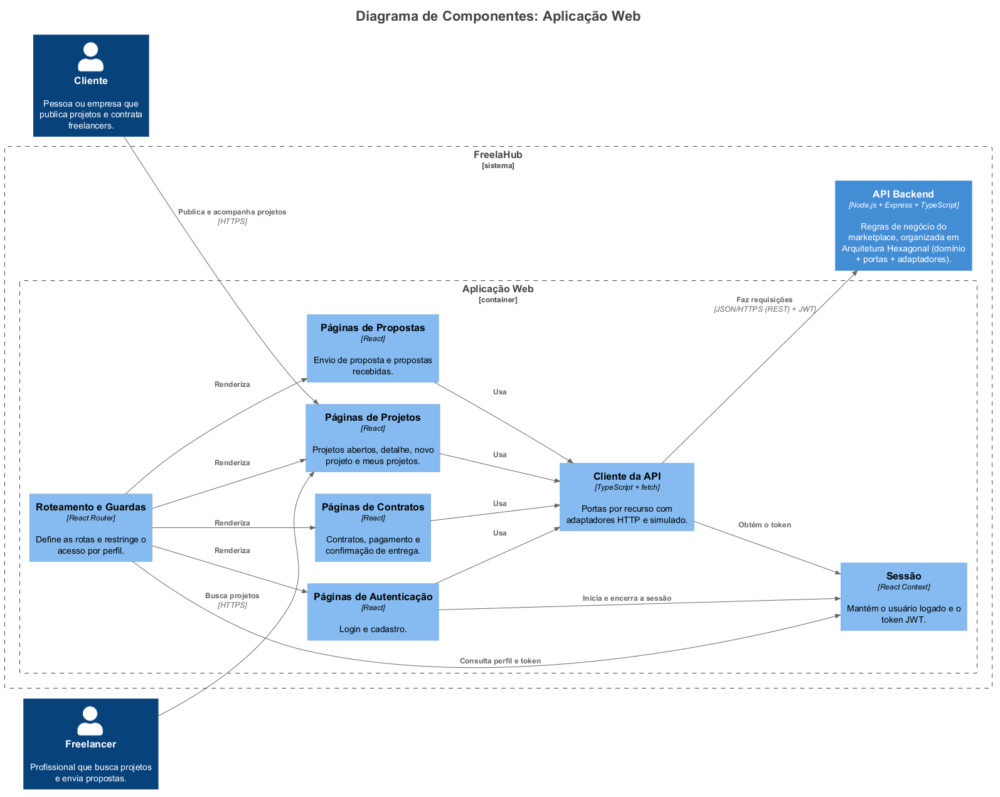
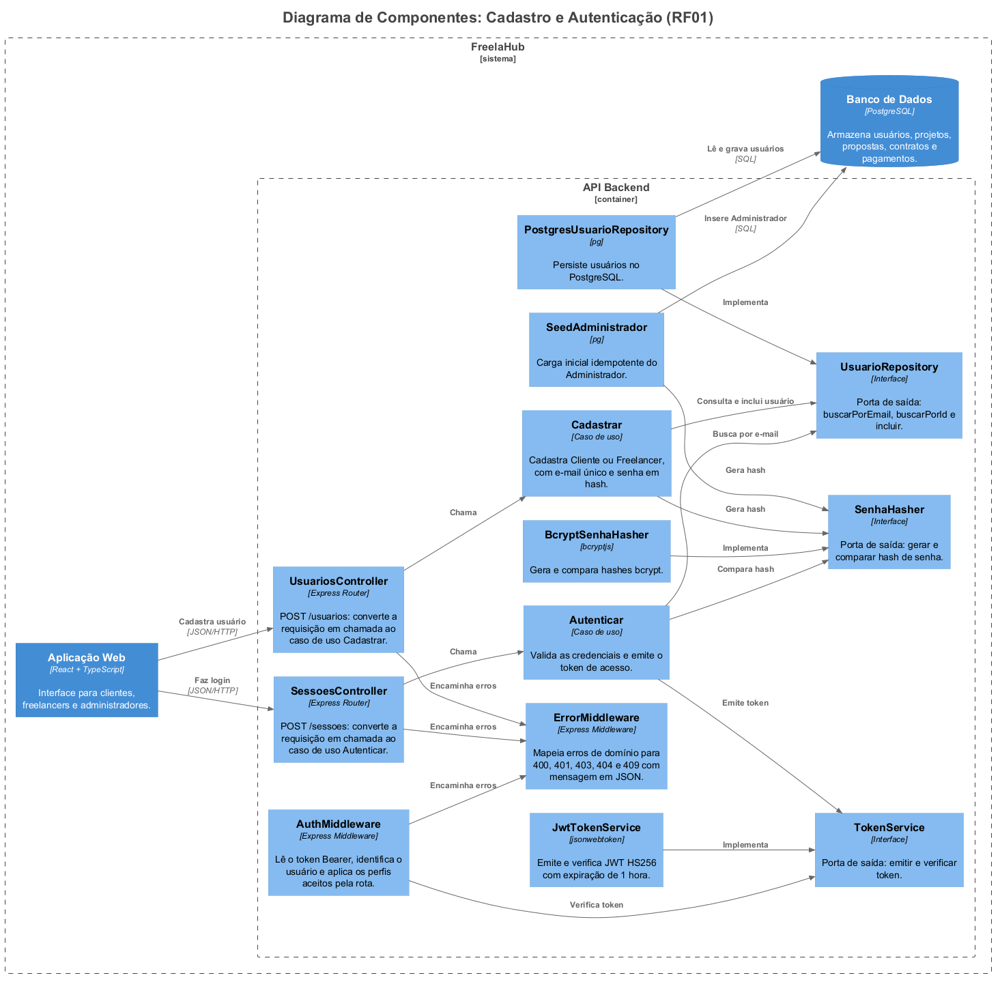
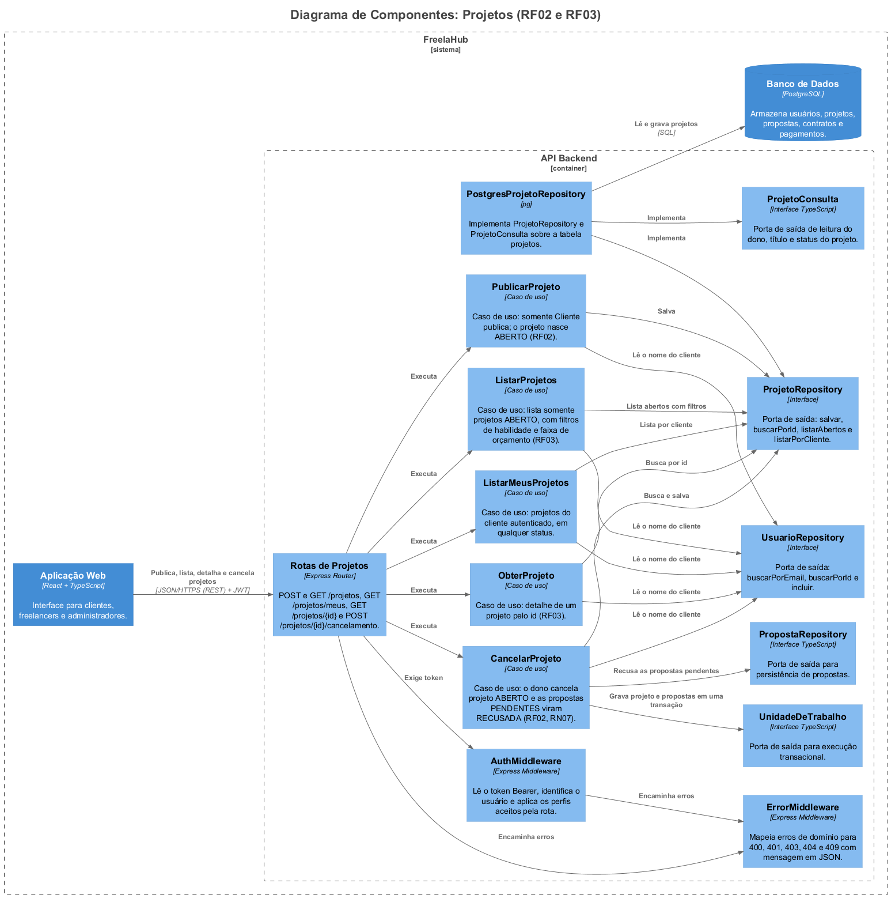
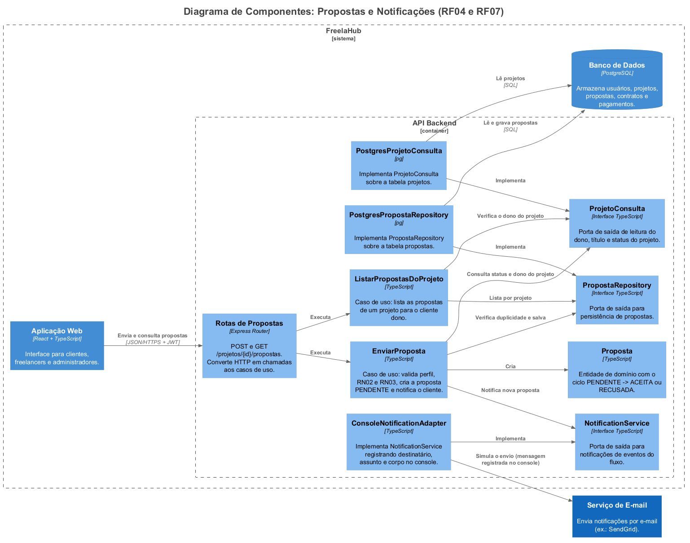
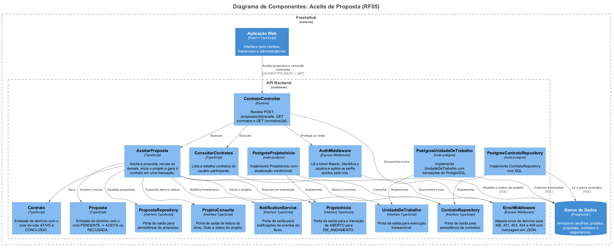
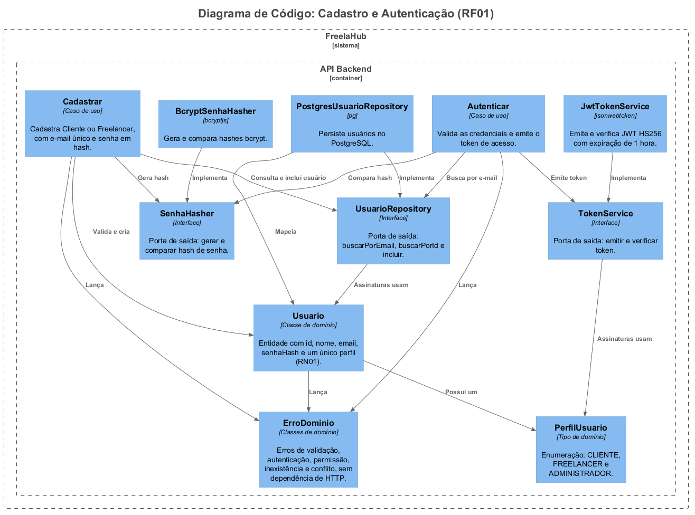
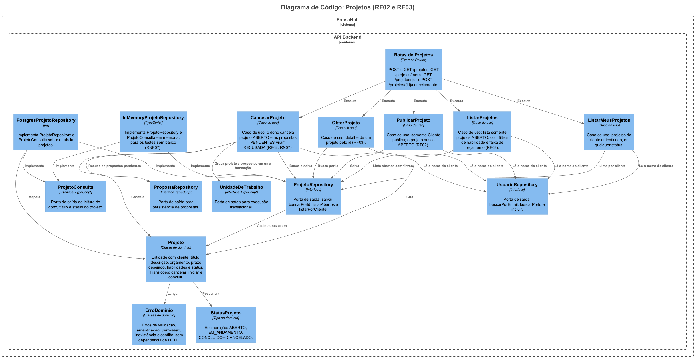
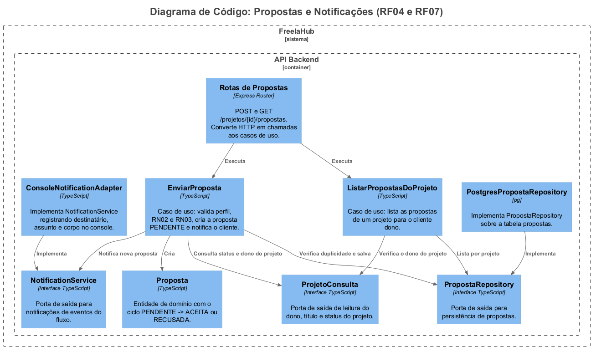
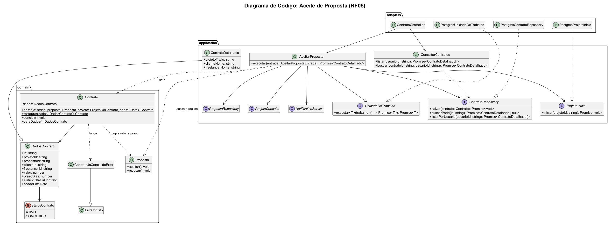

# Diagramas C4 do FreelaHub

Todos os diagramas do projeto, do nível mais geral ao mais detalhado. A fonte é o arquivo [`workspace.dsl`](workspace.dsl). Para navegar neles, cole o conteúdo em [playground.structurizr.com](https://playground.structurizr.com) e escolha a visão no menu.

## Nível 1: Contexto

### Contexto

## Nível 2: Containers

### Containers

## Nível 3: Componentes

### Aplicação Web

### RF01: Cadastro e autenticação

### RF02 e RF03: Projetos

### RF04 e RF07: Propostas e notificações

### RF05: Aceite de proposta

## Nível 4: Código

### RF01: Cadastro e autenticação

### RF02 e RF03: Projetos

### RF04 e RF07: Propostas e notificações

### RF05: Aceite de proposta

## Pendente

Os diagramas de Componentes e Código do RF06 (pagamento) entram com a fatia correspondente.
