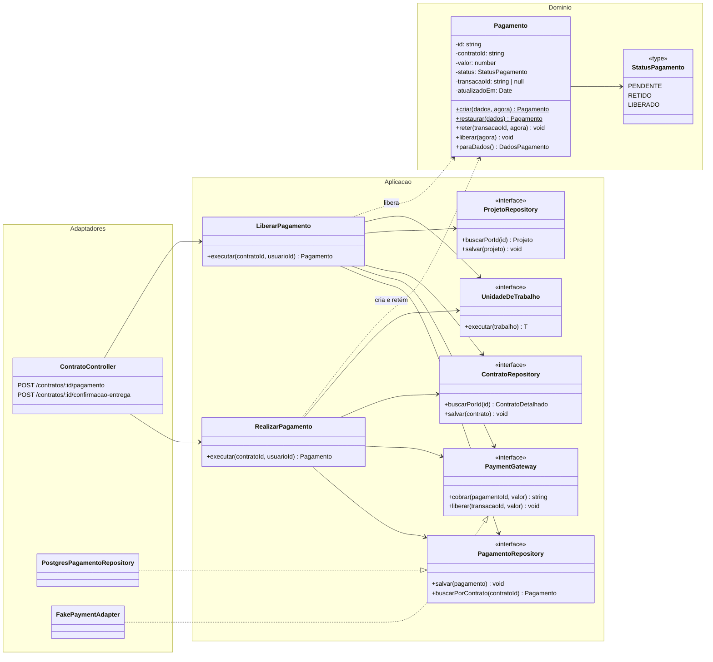

# Diagrama de Código: Pagamentos (RF06)

Nível 4 do C4 para a fatia de pagamento em escrow. O diagrama destaca os dois casos de uso principais; `ConsultarPagamento` é uma consulta auxiliar para o frontend. As setas tracejadas com triângulo indicam implementação de uma porta. A visão de componentes correspondente está definida como `RF06_Componentes` em [`workspace.dsl`](../workspace.dsl).

## Onde cada classe fica

| Classe | Camada | Arquivo |
|---|---|---|
| `Pagamento`, `StatusPagamento` | Domínio | `backend/src/domain/pagamento/Pagamento.ts` |
| `RealizarPagamento`, `LiberarPagamento` | Aplicação | `backend/src/application/casos-de-uso/` |
| `PagamentoRepository`, `PaymentGateway` | Portas de saída | `backend/src/application/ports/` |
| `ContratoController` | Adaptador de entrada | `backend/src/adapters/in/http/ContratoController.ts` |
| `PostgresPagamentoRepository` | Adaptador de saída | `backend/src/adapters/out/persistence/PostgresPagamentoRepository.ts` |
| `FakePaymentAdapter` | Adaptador de saída | `backend/src/adapters/out/payment/FakePaymentAdapter.ts` |
| `ConsultarPagamento` (consulta auxiliar) | Aplicação | `backend/src/application/casos-de-uso/ConsultarPagamento.ts` |
