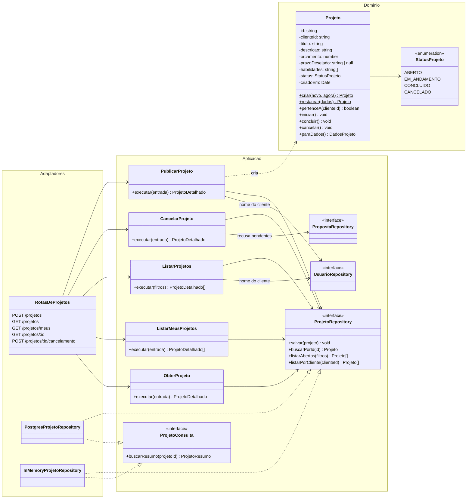

# Diagrama de Código: Projetos (RF02 e RF03)

Nível 4 do C4 para a fatia de projetos da API. As setas tracejadas com triângulo indicam implementação de uma porta. A mesma fatia também está modelada no Structurizr, na visão `RF02_Codigo` de [`workspace.dsl`](../workspace.dsl).

## Onde cada classe fica

| Classe | Camada | Arquivo |
|---|---|---|
| `Projeto` e `StatusProjeto` | Domínio | `backend/src/domain/projeto/Projeto.ts` |
| `PublicarProjeto` | Aplicação (porta de entrada) | `backend/src/application/casos-de-uso/PublicarProjeto.ts` |
| `CancelarProjeto` | Aplicação (porta de entrada) | `backend/src/application/casos-de-uso/CancelarProjeto.ts` |
| `ListarProjetos` | Aplicação (porta de entrada) | `backend/src/application/casos-de-uso/ListarProjetos.ts` |
| `ListarMeusProjetos` | Aplicação (porta de entrada) | `backend/src/application/casos-de-uso/ListarMeusProjetos.ts` |
| `ObterProjeto` | Aplicação (porta de entrada) | `backend/src/application/casos-de-uso/ObterProjeto.ts` |
| `ProjetoDetalhado` | Aplicação | `backend/src/application/casos-de-uso/detalharProjetos.ts` |
| `ProjetoRepository` | Aplicação (porta de saída) | `backend/src/application/ports/ProjetoRepository.ts` |
| Rotas de projetos | Adaptador de entrada | `backend/src/adapters/in/http/rotas/projetos.ts` |
| `PostgresProjetoRepository` | Adaptador de saída | `backend/src/adapters/out/persistence/PostgresProjetoRepository.ts` |
| `InMemoryProjetoRepository` | Adaptador de saída para testes | `backend/src/adapters/out/memoria/InMemoryProjetoRepository.ts` |

`ProjetoDetalhado` são os dados do projeto acrescidos do nome do cliente, que a interface mostra nas telas de listagem e detalhe. O nome é lido pela porta `UsuarioRepository` da fatia RF01.

Os dois repositórios de projetos implementam também a porta `ProjetoConsulta` da fatia de propostas, que antes tinha um adaptador próprio (`PostgresProjetoConsulta`).

## Transições do ciclo de vida

| Método | De | Para | Usado por |
|---|---|---|---|
| `cancelar()` | ABERTO | CANCELADO | `CancelarProjeto` (RF02, RN07) |
| `iniciar()` | ABERTO | EM_ANDAMENTO | `AceitarProposta` (RF05) |
| `concluir()` | EM_ANDAMENTO | CONCLUIDO | `LiberarPagamento` (RF06) |

Qualquer outra transição lança `ErroConflito`, que a API devolve como 409.
