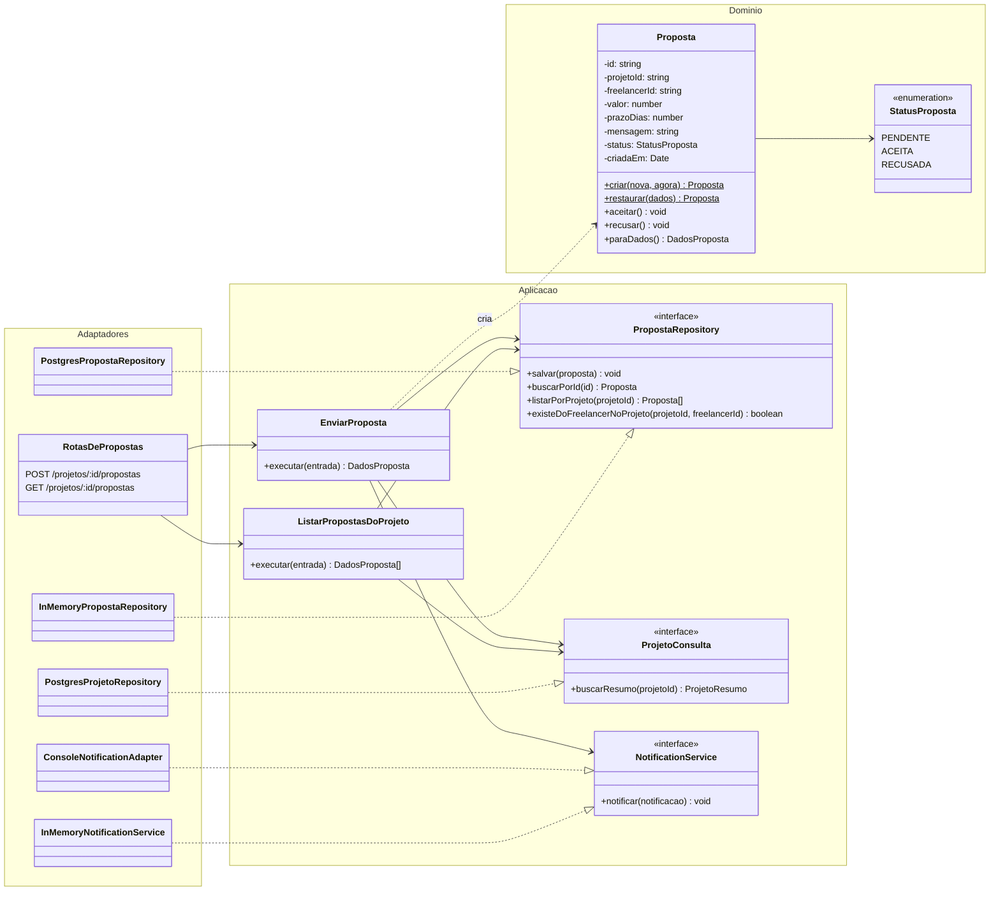

# Diagrama de Código: Propostas e Notificações (RF04 e RF07)

Nível 4 do C4 para a fatia de propostas e notificações da API. As setas tracejadas com triângulo indicam implementação de uma porta.

## Onde cada classe fica

| Classe | Camada | Arquivo |
|---|---|---|
| `Proposta` | Domínio | `backend/src/domain/proposta/Proposta.ts` |
| `EnviarProposta` | Aplicação (porta de entrada) | `backend/src/application/casos-de-uso/EnviarProposta.ts` |
| `ListarPropostasDoProjeto` | Aplicação (porta de entrada) | `backend/src/application/casos-de-uso/ListarPropostasDoProjeto.ts` |
| `PropostaRepository` | Aplicação (porta de saída) | `backend/src/application/ports/PropostaRepository.ts` |
| `ProjetoConsulta` | Aplicação (porta de saída) | `backend/src/application/ports/ProjetoConsulta.ts` |
| `NotificationService` | Aplicação (porta de saída) | `backend/src/application/ports/NotificationService.ts` |
| Rotas de propostas | Adaptador de entrada | `backend/src/adapters/in/http/rotas/propostas.ts` |
| `PostgresPropostaRepository` | Adaptador de saída | `backend/src/adapters/out/persistence/PostgresPropostaRepository.ts` |
| `PostgresProjetoRepository` | Adaptador de saída (fatia RF02/RF03) | `backend/src/adapters/out/persistence/PostgresProjetoRepository.ts` |
| `ConsoleNotificationAdapter` | Adaptador de saída | `backend/src/adapters/out/notification/ConsoleNotificationAdapter.ts` |
| `InMemory*` | Adaptadores de saída para testes | `backend/src/adapters/out/memoria/` |

`ProjetoConsulta` é uma porta estreita de leitura: a fatia de propostas precisa apenas do dono, do título e do status do projeto. Ela é implementada pelos repositórios de projetos da fatia RF02/RF03 ([diagrama](projetos.md)), que substituíram o `PostgresProjetoConsulta`.
